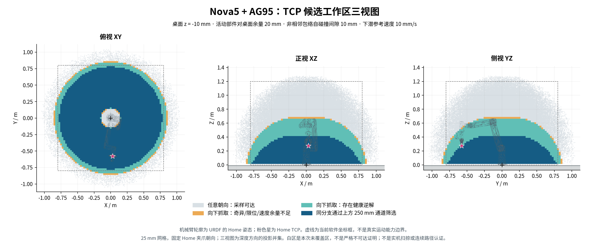
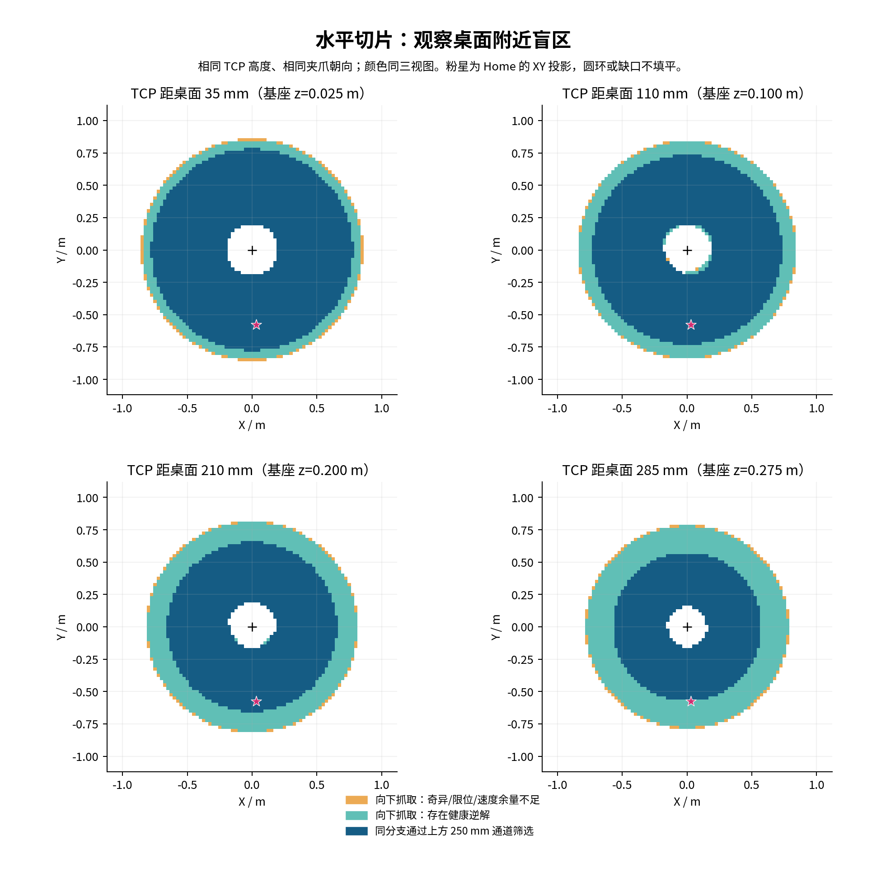
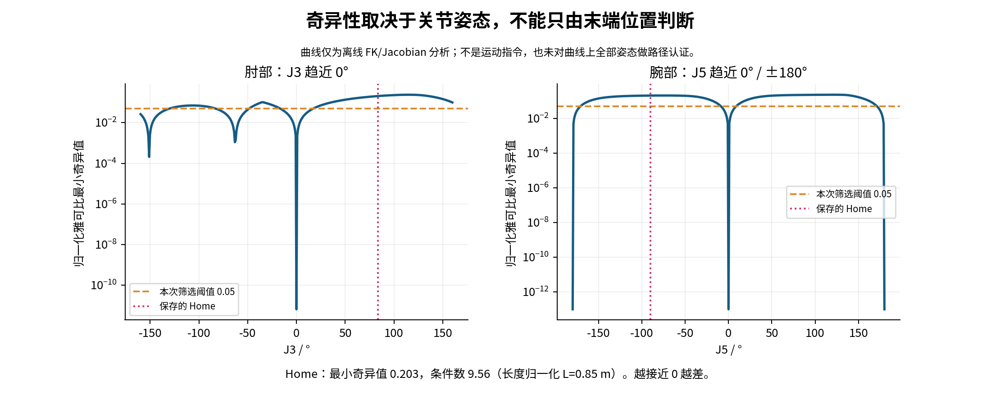

# 机械臂工作区、盲区与奇异性分析

2026-10-24。对象：现有 Nova5 + AG95 + 相机支架 URDF，抓取参考点 `grasp_link`。
本次仅离线计算、代码测试和 localhost 模拟控制器测试，没有发送实机运动或控制写入。

**结果：桌面附近的向下抓取工作区呈环形；靠根部和外缘应留出余量。当前 Home 在本次指标下
远离奇异位形，但现有规划器还缺少显式奇异性和整机地面检查，不能把测试通过等同于已实现这些保护。**

维护脚本精简用法见 [机械臂维护速查](../operations/arm-quickstart.md)。

## 三视图

| 颜色 | 含义 |
|---|---|
| 浅灰 | 任意朝向的关节空间采样，经过地面/保守自碰撞筛选 |
| 橙色 | 向下抓取能找到姿态解，但本次奇异性、限位或速度余量不足 |
| 青绿 | 固定 Home 夹爪朝向，至少存在一个通过条件筛选的逆解 |
| 深蓝 | 进一步通过同分支上方 250 mm 竖直通道的离线采样筛选 |

三视图沿深度方向取并集，投影可能遮住三维空洞；白区是本次未覆盖区域，不是严格不可达证明。
虚线只是当前软件的工作空间参数框。Home 是悬停参考，不需要再作为抓取目标向上抬 250 mm，
因此粉色 Home 星号不要求落在深蓝范围内。

## 桌面附近的盲区

以下是固定夹爪朝向、25 mm 网格的**径向包络**，不同方位未必都达到相同边界。
半径从机械臂基座 Z 轴计算；高度是 TCP 距桌面的高度，不能直接当作真实指尖接触高度。

| TCP 距桌面 | 有健康逆解的径向包络 | 再满足上方 250 mm 通道的径向包络 |
|---:|---:|---:|
| 35 mm | 约 0.20–0.85 m | 约 0.20–0.78 m |
| 110 mm | 约 0.18–0.84 m | 约 0.18–0.73 m |
| 210 mm | 约 0.16–0.81 m | 约 0.17–0.65 m |
| 285 mm | 约 0.15–0.78 m | 约 0.15–0.57 m |

在整个向下抓取图中，通过地面/自碰撞筛选的 TCP 基座高度约为 0.025–0.675 m；
增加本次条件筛选后约为 0.025–0.650 m；再要求上方 250 mm 通道后，抓取高度约为
0.025–0.400 m。这些是采样边界，不能当成一个完整长方体来使用。

可作为后续现场验证起点的矩形：**X∈[-0.25,0.25] m，Y∈[-0.65,-0.25] m，
TCP 基座高度 0.025 m（距桌面 35 mm）**，大小约 50×40 cm。
该矩形 357 个网格点全部通过同分支竖直通道粗筛，且位于当前软件坐标框内。
这不证明从 Home 转移到每个点的路径已经通过业务规划、历史旋转约束或实机碰撞验收。

## 奇异点与 Home

采用几何雅可比 `J=[Jv;Jω]`，以 0.85 m 特征长度将线速度部分归一化后计算 SVD。
最小奇异值接近零表示局部运动能力退化；同一 TCP 位置可能有一个奇异解和另一个正常解，
因此地图在每个位置比较多个逆解，而不是按位置简单标记“奇异点”。
方法背景见 [Modern Robotics：Singularities](https://modernrobotics.northwestern.edu/nu-gm-book-resource/5-3-singularities/)
及 [Manipulability](https://modernrobotics.northwestern.edu/nu-gm-book-resource/5-4-manipulability/)。

- 保存的 Home：最小奇异值约 **0.203**，条件数约 **9.56**，通过本次筛选。
- 把 Home 的 J5 改到 0°，能复现腕部奇异；把 J3 改到 0°，能复现肘部奇异。
- 扫描中还有由整机姿态共同造成的低谷，因此只避开某个关节的固定角度区间并不足够。
- 奇异性主要影响笛卡尔求解与速度放大，关节运动并非一律不能经过奇异位形。
  本图按后续竖直抓取需求作保守筛选，不把某个关节角度直接定义为禁止区。
- 当前 Home TCP 基座高度约 0.275 m，距桌面约 285 mm。以本次模型的 35 mm 抓取高度
  加 250 mm 预抓偏移，正好接近这个悬停高度。

## 本次测试结果与代码缺口

| 检查 | 结果 |
|---|---|
| 旋转约束库 | 20 个 C++ 测试通过 |
| 机械臂控制节点 | 26 个 C++ 测试通过 |
| 原反馈/协议验证 | 4 个离线/loopback 测试通过（加载 ROS 运行库环境后） |
| 独立维护工具 | 11 个 C++ 测试通过 |
| ROS 端到端 | 抓取序列、忙碌拒绝、夹爪失败/超时、取消和 Stop 失败锁定通过；20 次接受取消均返回 CANCELED |
| 维护脚本端到端 | localhost 清错/使能/TCP 条件、直接 Home、Ctrl+C Stop、采集备份和重复反馈拒绝通过 |
| 数值交叉检查 | FK 与独立 URDF FK 最大绝对差约 2.2e-16；雅可比与中心差分误差约 2.0e-10 |
| 地面分类交叉检查 | 64 个随机姿态的包络分类与逐顶点最低高度检查一致 |

发现的缺口：

1. **规划器缺少显式奇异性门限。** 调用当前真实 `Planner`，使用只返回对应 FK 已验证逆解的
   离线夹具，9 个肘部奇异终态中有 7 个预抓规划被接受。其中一个终态的最小奇异值约
   6.8e-12、条件数约 2.6e11。该测试不连接厂家 SDK、不发送运动；说明 FK/IK 残差和
   速度限幅没有替代奇异性检查。接受此 PTP 终态不证明这次关节运动本身一定危险，
   但从该终态继续笛卡尔下潜需要相应策略。证据：`policy-probe.json`。
2. **运行节点没有整机地面/自碰撞检查。** `validatePose` 只检查 TCP 坐标框和朝向。
   找到 12 个 TCP 高于桌面、位置/朝向校验通过，但其他几何已穿过桌面的静态姿态。
   这些反例的完整 PREGRASP 夹具因其他条件被拒绝，不能据此声称当前节点实际批准了穿桌运动；
   它们证明的是 TCP 校验本身不能代表整机碰撞校验。本次地图的碰撞筛选尚未接入运行节点。
3. **端点可达不等于当前业务路径可执行。** 当前 PTP 预抓转移也检查沿途末端朝下，
   而地图没有验证从 Home 到每个点的转移路径；连续旋转历史、2 mm 下潜规划和具体 IK 返回分支
   仍可能进一步缩小业务可用范围。

建议优先把完整几何碰撞和可配置的雅可比条件检查接入规划路径采样，再用候选矩形中的少量点
进行现场低速验证。**这次没有改变运行节点的保护策略或开启实机执行。**

## 计算假设与数据

- 用户给定：机械臂安装基准比桌面高 10 mm，故将无限水平桌面设为 `base_link` 的 z=-0.010 m。
  默认 URDF 没有地面；源 Xacro 可选地面的顶面是 z=-0.005 m。本次使用用户给定的桌面高度。
- 对 Link1–Link6、相机/支架和夹爪几何检查桌面余量 20 mm；静止底座的安装接触单独豁免。
  夹爪在 0–0.94 rad 内取 21 个开度，使用其并集包络，未仿真夹爪受力。
- 地面高度极值由碰撞 STL 顶点的凸包精确保留。自碰撞采用 FCL 保守凸包，非相邻组要求
  10 mm 间隔；同一末端组及直接相邻关节组明确排除。这会产生保守误拒，不是完整 SRDF/ACM。
  Home 以及 16 个抽样候选姿态，在三种代表夹爪开度下的非相邻原始三角网格检查均未检出接触。
- 任意朝向：262,144 个 Sobol 关节样本；向下抓取：451,497 个空间网格点、8 个典型逆解分支，
  保持 Home 的世界夹爪朝向。全部入选解通过 URDF FK 残差验证；最大位置残差约 1.6e-15 m，
  最大姿态近似残差约 7.4e-6 rad。旋转夹爪后自碰撞关系可能改变，应按具体朝向复核。
- 筛选条件：关节位置离限位至少 5°、归一化最小奇异值 ≥0.05、条件数 ≤80，
  10 mm/s 竖直运动的雅可比预测关节速度不超过当前 0.25 rad/s 配置上限。
  这些是本次工程筛选阈值，不是厂家认证值。
- 250 mm 通道采用同一肩/肘/腕分支、每 25 mm 高度采样并检查分支连续性。
  未执行 2 mm 全分辨率路径规划、连续碰撞检测或从 Home 到每个点的可达连通性证明。
- TCP 仍是标称 0.20 m 法兰轴向偏移，实机尚未标定；桌面边界、棋子、障碍物、线缆形状和
  安装误差未建模。地图是候选分析结果，不是实机安全范围或碰撞认证。

完整数值见本目录的 `workspace-20261024/summary.json`、`height-slices.csv`、
`verification.json`、`policy-probe.json` 和 `analysis-checks.json`。图支持 PNG 和本地 SVG 导出。
生成工具与复现步骤：[`tools/analysis`](../../tools/analysis/README.md)。
