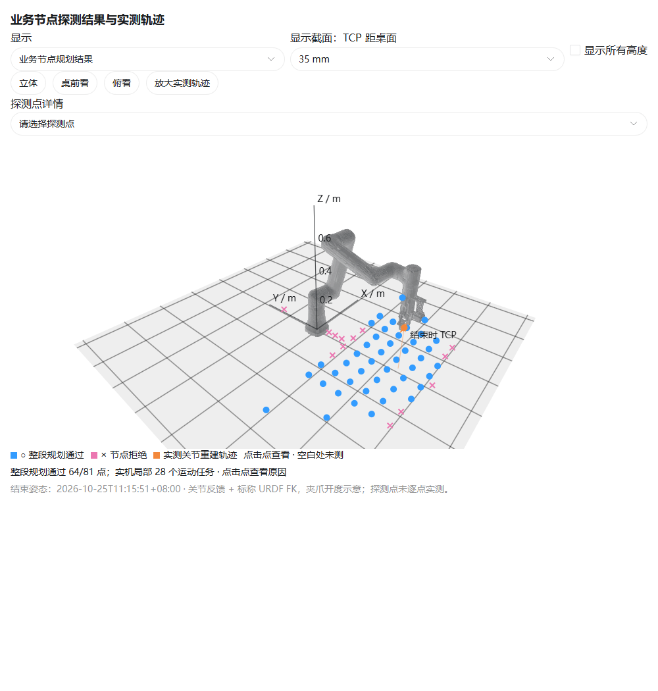
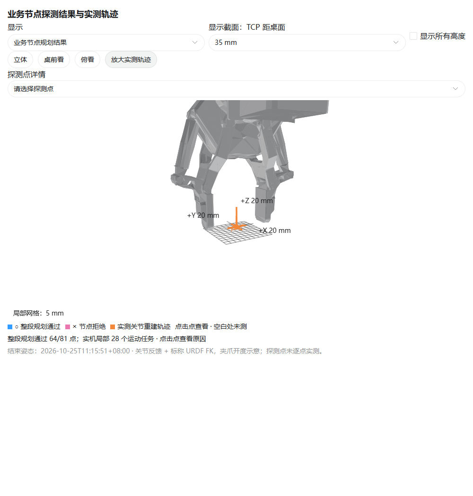

# 业务节点实测、可达性与代码核查

2026-10-25。目标运动通过真实 `/arm/move` Action → 现有 Planner → 厂家 FK/IK → 扭转检查 → Executor → ServoJ；没有用维护工具的 MovJ 替代业务执行。实机采用默认关闭的 `commissioning` 调试后端，同一套规划、驱动和执行代码，配置更严格；正式运行的验证开关未设为 true。

## 实机结果

最终一轮 **28 个运动任务通过：27 个确认到位，1 个按预期取消并确认停止**。覆盖 Home、左右及前后各 5/10 mm、上方 5/10/20 mm，以及 2 mm 下潜、撤离。最后回到正式 Home，反馈新鲜、mode=5，参考保持有效。到达 Home 不会自动清零扭转。

实机配置：Home 周围 TCP 半径 30 mm、各关节偏离 Home ≤0.1 rad；规划关节速度上限 0.02 rad/s、加速度 0.05 rad/s²；测试 profile 为 0.01 rad/s、0.04 rad/s²；净/总扭转各限 20°。所有规划采样与执行反馈均经过几何保护检查。

| 实测记录 | 结果 |
|---|---:|
| ROS 发布的真实关节反馈 | 10,113 帧 |
| 控制器 Stop 成功回包耗时 | 0.487 s |
| 请求取消到确认静止并返回终态 | 0.906 s |
| 净扭转绝对峰值（ROS 状态） | 约 1.98° |
| 总扭转峰值（ROS 状态） | 约 2.07° |
| 原始 QDActual 换算的关节速度峰值 | 约 0.0291 rad/s，即 1.67°/s |

规划速度约束与控制器实际响应须区分。当前调试后端的反馈速度监测阈值为 `1.5 × 规划关节上限 + 0.002 rad/s`，本次是 0.032 rad/s；反馈中的瞬时峰值高于测试 profile，但未达到该监测阈值。这些配置不是控制器物理硬限速或加速度认证。

实际轨迹的 TCP 坐标极值：X 20.33～40.36 mm，Y −586.53～−566.50 mm，Z 272.62～294.67 mm。上方 20 mm 目标的反馈重建位移约 19.7 mm，处于当前到位容差内。**坐标来自编码器与标称 URDF，不是独立 TCP 测量；坐标极值也不能当作整个包围盒均已实测。**

正式 Home 两份 YAML 的 SHA256 均保持为 `165f3ec9727f78bd5069538aa0029fd96275574dfd882db472a08b36a1be634a`。采集和故障诊断没有覆盖正式 Home。

## 使用真实节点扫描范围

从本轮 Home 状态出发，固定夹爪向下和 Home 朝向，对每个目标请求完整预抓、250 mm 下潜及撤离的 plan-only 序列。厂家 IK 使用节点现有的“当前关节姿态、Home”两组 seed，保留真实选解代价与连续扭转历史；范围扫描使用正常的净扭转 ±360°、总扭转 360° 参数。额外几何保护与实机调试相同。

**81 个空间采样点中，64 个通过，17 个拒绝。** 另外在 Home XY 处测试了绕竖直方向的 −180°、−90°、−45°、45°、90°、180° 请求，六个完整序列均通过只读规划。±180° 是同一末端姿态的两种输入表示；这些朝向变化没有执行实机运动。

| TCP 高于用户桌面 | 采样点数 | 完整序列通过 |
|---|---:|---:|
| 35 mm | 57 | 44 |
| 110 mm | 12 | 11 |
| 210 mm | 12 | 9 |

常规桌前网格为 X∈[−0.35,0.35] m、Y∈[−0.75,−0.25] m，步长 0.1 m；较高两层使用稀疏网格。另探测近基座、远端、左右及后侧的 9 个点。图只画采样点，空白位置未测试，不插值成连续可达区域。

拒绝原因：厂家运动学拒绝 11 点、关节限位余量不足 2 点、奇异性阈值 2 点、自碰撞包络余量 1 点、防扭转 1 点。例如：

- `[0, 0.30, 0.025] m`：被防扭转限制拒绝，说明叠加扭转约束确实会改变工作范围。
- `[0, −0.15, 0.025] m`：非相邻部件的保守包络间距不足。
- `[0.35, −0.65, 0.10] m`、`[0.15, −0.65, 0.20] m`：当前候选路径接近配置的奇异性阈值。

几何保护：用户桌面 z=−0.010 m，活动部件留 20 mm；非相邻包络间距 10 mm，21 个夹爪开度的联合末端包络；关节限位余量 5°；以 `J=[Jv/0.85; Jw]` 归一化，最小奇异值 ≥0.05、条件数 ≤80，属于本次工程筛选阈值。静止底座、相邻连杆、固定末端组的内部接触按原分析约定排除。它检查离散采样，未建立完整现场环境或连续碰撞证明。

**这些结果表示当前实现、当前参考状态和固定抓取姿态下的工序可规划性。拒绝不等于机械本体在所有逆解、所有路径下不可达；通过也不代表任意两点间都能直接运动。全工作区采样点没有逐点实测，实机验证限于上面的 Home 邻域。**

## 实测发现并修复的问题

1. **IK 数值格式**：接近零的角度被输出为科学计数法，真实控制器返回 `−30005`；同一目标改为定点小数即可成功。驱动现统一输出普通小数，回归测试覆盖该输入。
2. **命令连接**：频繁短连接出现查询超时；控制器又拒绝同一主机的第二条命令连接。驱动改用有序长连接，Stop 复用该会话。有效的负回包保留会话，传输或回包歧义丢弃会话，不自动重发运动。
3. **反馈时间戳**：只读静止扫描捕获到相同毫秒时间戳、但数据略有变化的相邻真实帧。旧逻辑会误判并丢失参考。现在丢弃所有时间戳未前进的帧，不刷新新鲜度、不推进扭转；真正倒退、持续无新采样及关节跳变仍触发故障。没有通过自动重建参考来绕过问题。
4. **Stop 超时预算**：普通查询的 500 ms 预算及网络层固定等待上限不适合停止确认。现采用独立的 1.5 s Stop 回包预算和 4 s 总停止确认期限，并以新鲜、低速、mode=5 的反馈持续停留确认停止。回归测试包含延迟 600 ms 的 Stop 回包。
5. **异常分类**：运动已尝试后的非类型化回包异常现返回执行失败，保留 `executed=true`，并进行停止处理；不再误报为规划失败。

前三轮局部调试保留了 STOP_FAILED 等原始失败记录。每轮均终止后续运动，关闭故障会话后单独发送恢复 Stop 并确认静止，再修复代码。恢复期间维护工具只做只读反馈预览，预览中的 MovJ 字符串未发送。最终一轮才完成上述 28 个运动任务；没有删除失败记录或自动重放失败运动。

## 仍需明确的业务行为

**现有低扭转偏好是加权代价，不能保证优先回正。** 新增受控离线测试使用两个 FK 精确等价的解：已有 330° 扭转的快解，以及最终 −30°、需要完整反向解绕的解；两条路径均经过当前规划与几何保护检查。默认时间权重会保留 330°，降低时间权重才选择 −30°。这是离线反例，未让实机旋转到 330°。

因此，我不建议把“有低扭转代价”当作“保证先回中性”。如果业务要求先消扭再比较耗时，应改变排序优先级或明确回正触发条件，单靠权重会受到速度 profile 的影响。本轮保留现有规则，并将该行为纳入回归测试。

时间参数化也较保守：测试中部分 10 mm 动作约需 30 s，上方 20 mm 任务约需 56 s（含规划和到位确认）。它满足本次慢速验证目的，但当前耗时还不适合作为正常抓取效率指标。

## 验证与交付

- colcon 统计 62 项测试通过，无错误、失败或跳过；独立维护工具 ctest 通过。
- ROS 回环端到端通过，包含只读无运动、抓取确认、超时不撤离、取消、异常 ServoJ 回包及 Stop 失败锁定；夹具仅绑定 127.0.0.1，并使用 `/simulation/arm/*`。
- 真实节点只读负向测试通过：超出 Home 调试包络、下潜 XY 不对齐、向上请求下潜、极小扭转上限均被拒绝，未产生运动。
- 交互图通过桌面、窄屏及深色模式检查；支持选择高度、点位拒绝原因、旋转观察和放大实测轨迹。

摘要：`physical-results.json`、`physical_summary.json`、`workspace-results.json`、`workspace_summary.json`。原始轨迹、回包和反馈保留在本地证据包及 AGX 的 `runs/business_probe_20261025/`。代码入口为 `src/chess_robot_arm/`，可复现扫描脚本为 `tools/analysis/business_node_acceptance.py`；简要操作见 `QUICKSTART.md`。正式默认仍为只读，调试覆盖配置的使能开关仍为 false。
