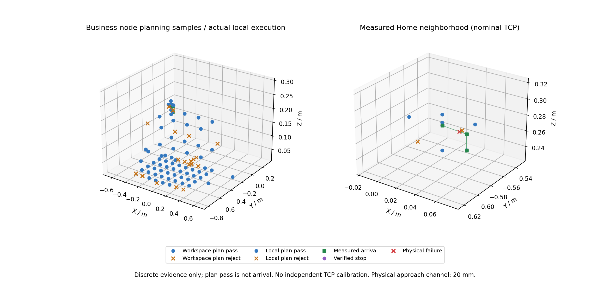

# 业务节点验证与 ServoJ 时序排查

2026-10-25。**选解策略和回归已完成；实机扩大验证在首批回 Home 时被时序保护中止，30/35 mm 批未执行。** 本轮 7 个真实运动任务：5 个反馈确认到位、1 个取消后确认停止、1 个执行失败。未重放失败动作，未使用维护 MovJ，未自动清零扭转参考。

## 选解优先级

当前规则：总扭转 → 净扭转绝对值 → 耗时。总扭转先比较，避免相反局部扭转抵消成“中性”。5° 中性带内视为等价；相对当前 seed 候选，需要超过 2° 的角度改善才因消扭换支，扭转等价时需要超过 1 s 的耗时改善。旧 cost 参数为兼容而接受，不再参与排序。比较只操作规划快照，不改变真实参考。

回归覆盖 FK 精确等价的 330° / −30° 解：即使时间权重极大、使用慢速 profile，也优先选择低扭转解；另覆盖中性边界噪声、滞回、局部扭转抵消、回正路径被几何保护拒绝，以及扭转硬限收紧后的拒绝。保护不因优先回正而绕过。

选择范围仍是厂家 IK 的当前姿态/Home 两个 seed 所得候选，未证明所有逆解的全局最优；无可行回正路径时可保留当前安全候选，所有路径硬限照常生效。

## 实机与范围

所有动作经 `/arm/move` → Planner → 厂家 FK/IK → 扭转/几何检查 → Executor → ServoJ。完整预抓、下潜、撤离先整体规划，实际分阶段执行并确认反馈；未伪造夹爪抓取确认。

| 本轮任务 | 真实结果 |
|---|---|
| 初始 Home、取消后的 Home | 均反馈到位 |
| 发生可测位移后取消 | Stop 成功，约 1.010 s 后确认停止 |
| 25 mm 首批 PREGRASP | 反馈到位，TCP ≈ [54.99, −576.22, 272.90] mm |
| DESCEND，约 20 mm | 反馈到位，TCP Z ≈ 252.88 mm |
| RETREAT | 反馈到位，TCP Z ≈ 272.93 mm |
| 随后业务 Home | 执行失败，ServoJ schedule overrun；已确认停止 |
| 30/35 mm 批 | 未执行 |

25 mm 名称指相对启动反馈的目标偏移；启动关节距正式 Home 最大约 0.00237 rad。先完成正式 Home 后，实际横向到达位移约 24.6 mm。坐标均由真实编码器和标称 URDF 重建，**没有独立 TCP 测量标定**。实机通道为 20 mm 预抓高度，默认 250 mm 工序没有在本轮完整实机执行。

当前策略的真实节点只读预检：8 个局部候选，6 个通过，前方 30 mm、后方 35 mm 被关节调试包络拒绝。通过路径独立复核：保守桌面距离 ≥153.5 mm、非相邻部件距离 ≥21.17 mm、关节限位余量 ≥1.2629 rad、归一化最小奇异值 ≥0.1943、条件数 ≤9.95。路径为离散采样，距离为相应包络下界；不代表连续碰撞证明。

本轮运行使用候选包络 TCP 40 mm / 关节 0.12 rad；保存的默认模板仍为 30 mm / 0.1 rad，`hardware.enable=false`。净/总扭转各限 20°，规划速度/加速度上限 0.02 rad/s、0.05 rad/s²，profile 0.01 rad/s、0.04 rad/s²。实测 ROS 反馈速度峰值约 0.01462 rad/s，总扭转峰值约 0.11383 rad，均未触发反馈门限。实机失败后不据此宣称更大包络已验证。

[交互三维范围图](business-range.html)；蓝色为规划通过，橙叉为规划拒绝，绿色为实机到位，紫色为确认停止，红叉为实机失败终态位置。全局背景是 **0b15c6d 历史扫描的 64/81 点**，局部点和轨迹是本轮；新策略没有重新全局扫描。

## 失败原因与排查

12:44:18（台北时间），最后一条 ServoJ 返回有效成功回包，但耗时 **63.099 ms**。执行器按 30 ms 固定节拍同步等待每条回包，随后发现落后超过一个周期并中止。回包后约 **0.722 ms** 开始 Stop；Stop 成功回包耗时 **562.082 ms**，随后以新鲜、低速、mode=5 反馈持续确认停止。没有把成功回包当作到位，也没有继续发送后续运动。

停止位置 TCP ≈ [47.565, −576.415, 273.552] mm，关节距 Home 最大约 0.03062 rad；**尚未回 Home**。结束反馈参考有效；脚本关闭节点后，本次内存参考结束。当前没有跨进程参考恢复机制，不应在该位置重建参考来绕过 Home 条件。

| 证据 | 结果与含义 |
|---|---|
| 5,363 次实机 ServoJ | 回包中位数 6.803 ms，P99 12.015 ms；3 次 >30 ms，1 次 >60 ms |
| 慢回包附近原始反馈 | 仍持续收帧，附近间隔最大约 18.8 ms；不支持整个进程统一停顿 63 ms 的解释 |
| 停止后 2,000 次只读 GetAngle | 无错误、无 TCP 重传；最长 11.304 ms，未复现慢回包 |
| 同期 1,000 次 ping | 无丢包；最大 RTT 1.084 ms；不能排除故障当时的瞬时网络抖动 |
| 主机 2 ms 定时探针 | 抖动 P99 约 0.105 ms，峰值 7.308 ms；是事后观测，不能倒推故障时调度 |
| 现有 C++ 接收实现只读对照 | GetAngle 500 次最长 3.484 ms；PositiveKin 500 次最长 12.074 ms，线程 CPU 峰值 <0.7 ms |

**已定位直接触发链：单次 ServoJ 回包尾延迟 → 同步问答阻塞后续节拍 → 时序保护停止。尾延迟究竟来自控制器处理、瞬时网络还是执行线程调度，现有证据不足以最终归因。** 现场无障碍是用户确认信息，本次错误也未报告碰撞、奇异性或到位误差。接收逐字节开销不足以单独解释 63 ms。

原厂协议 V4.6.6 第 101–102 页建议 ServoJ 约每 30 ms 调用；`t`、提前量和增益影响跟踪行为，不能据此保证回包硬实时。资料见仓库 `docs/vendor/dobot/`。本轮未改周期、增益或停止阈值以掩盖故障；新增采样序号、实际落后时间及上一条 I/O 耗时诊断，以及 90 ms 慢回包中止、不重放、Stop 验证回归。

下一次运动前需要可审计地恢复已知 Home 和参考连续性；之后应在独占命令会话下采集发送/首字节/完整回包与线程调度时间线，再评估有界异步收发或更保守周期。任何方案仍须保留回包匹配、队列顺序、停止优先级和超限即停，先回环验证，再新批低速实测。

## 交付与复现

- Arm 38 项、Twist 20 项单元回归通过，包含慢 Stop 回包预算及慢 ServoJ 中止；ROS 回环端到端通过，覆盖取消、异常回包与停止失败锁定。
- 正式两份 Home YAML 的 SHA256 仍为 `165f3ec9727f78bd5069538aa0029fd96275574dfd882db472a08b36a1be634a`。正式认证标志保持 false。
- 本轮摘要：`neutrality-physical-results.json`、`neutrality-local-plan-results.json`、`neutrality-margins.json`、`neutrality-timing.json`、`neutrality-latency.json`、`neutrality-cpp-latency.json`。失败原始结果未改写为成功。
- 完整轨迹、回包、二进制反馈和只读探针在 AGX `runs/neutrality_probe_20261025/`；历史失败和 27 到位 / 1 停止记录保留在 `runs/business_probe_20261025/`。历史范围摘要仍在同目录旧 JSON，不能混计为本轮结果。
- [操作参考](../../operations/arm-business-acceptance.md)。绘图、独立几何复核和只读时序探针分别为 `business_evidence_plot.py`、`business_evidence_audit.py`、`business_latency_probe.py`。本轮状态为**部分完成、实机扩大验证阻塞**。
