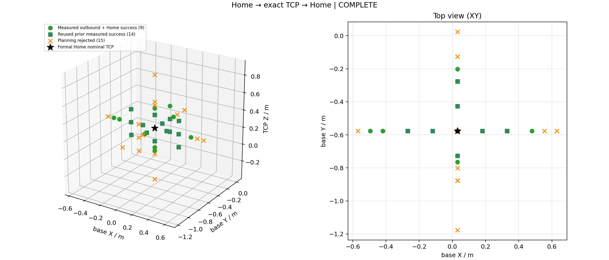

# Home → 实际 TCP → Home：200 ms 续测验收

2026-10-26。**预定有限清单与六方向加密已完成，最终在正式 Home 停稳，保留同一份扭转历史。**

本批 `runs/feedback_gap_20261026/physical200_02`：原26个粗扫点及12个加密点全部有记录，38个不同目标中历史成功复用14、本批新实测往返成功9、规划拒绝15。low/high在新二进制与200 ms上下文各完成一组实测往返。包括一次low Home恢复，本批实际23段运动均完成，无执行故障、无自动重放或故障返Home。实际动作全部由原 `/arm/move` 执行，TCP为精确终点、固定原Home朝向，无预抓高度/夹爪/下潜/撤离动作。

本批运行约149.74 s；复用旧14点因此无需重复整表运动。首次入口 `physical200_01` 被遗留100 ms内部cap在连接前拒绝，零运动，补齐exploration 200 ms参数校验后采用新02目录；不把01计作实机动作或执行故障。旧10/25和今天前一批故障原结果及SHA完整保留。

## 有限方向结果

距离是从项目正式Home沿基座坐标轴的偏移，单位m；方向向量见原manifest。更远拒绝属于当前型号、固定朝向和配置保护下的规划结果。以下是稀疏测试区间，**不是全局工作区/连续路径认证，也不是无误差的精确机械极限**；按预先约定每方向仅2个加密槽，完成后结束，没有继续扩点。

|方向|最远实测往返偏移|该实际TCP标称XYZ|更远规划拒绝偏移|剩余区间宽度|
|---|---:|---|---:|---:|
| left | 0.5250 | -0.494649, -0.576519, 0.274988 | 0.6000 | 0.0750 |
| right | 0.4500 | 0.480351, -0.576519, 0.274988 | 0.5250 | 0.0750 |
| front | 0.3750 | 0.030351, -0.201519, 0.274988 | 0.4500 | 0.0750 |
| back | 0.1875 | 0.030351, -0.764019, 0.274988 | 0.2250 | 0.0375 |
| up | 0.2250 | 0.030351, -0.576519, 0.499988 | 0.2625 | 0.0375 |
| down | 0.2625 | 0.030351, -0.576519, 0.012488 | 0.3000 | 0.0375 |

`targets.csv`逐点保存坐标、规划/去程/返程状态、实际反馈误差、耗时与拒绝原因；原`results.json`保留完整去返腿和历史复用上下文。规划拒绝包括配置工作区及无可验证IK候选等，均未强行执行。历史14点仍带旧100 ms时间戳/来源，不冒充本批200 ms新增到位。

## 实测与保护

正式Home两份YAML SHA256 `165f3ec9727f78bd5069538aa0029fd96275574dfd882db472a08b36a1be634a`，原TCP/URDF/geometry/SDK与5个接口定义未变。目标和终点反馈均为base_link；joint/state/TCP沿用同份反馈ROS接收时间，未将控制器原时间当ROS stamp。

用户本轮明确要求继续并把测试反馈窗口改为200 ms。工具默认仍100 ms；本批通过`--feedback-freshness-s .2 --feedback-window-evidence ...`绑定实际原话、旧新门限、两份原fault结果SHA。continuation明确记录唯一授权差异，不伪称安全参数完全一致。exploration内部允许最大200 ms且测试200.001 ms拒绝；commissioning保留原100 ms cap。到位1 mm/0.005 rad/0.0005 rad、静止0.002 rad/s与0.4 s dwell、跟踪0.15 rad，以及碰撞/奇异性/关节/扭转/停止保护未放宽。

速度继续采用已授权用户策略：普通high请求1 rad/s、1 rad/s²；边界/近桌/约束余量低使用low 0.3 rad/s、0.3 rad/s²，受官方模型和controller约束；不是SDK速度百分比，更不把本机未知硬件上限伪装成已认证。短路径不保证达到请求峰值。

完整13份原始反馈审计回放，包含原mode9尾及已声明的断电后原文件边界；只在明确指定文件边界允许新controller epoch，原字节与时间不改写。断点后用户确认无外部运动/拖拽/复位/改线，live末关节仍需原0.001 rad join及静止dwell。恢复前net/total约-0.51638/0.52038 rad，保留非零累计；未自动清零。今日Home返程只是物理回到旧Home，不是重新定义参考。当前批次没有新EnableRobot、ClearError或Stop命令：原本已enabled idle，正常所有返程均实测完成。

本批新目标及资格22段到位TCP误差约0.014–0.409 mm，最大朝向误差0.000128 rad；这是关节实测反馈结合既有TCP模型得到的误差，不是外部测量认证。最后原始反馈连续约0.620 s满足mode5、原静止阈值及Home关节容差。最终参考有效、Home到位，随后业务节点和抓包正常退出，未继续运动。

## 反馈空窗评估

独立报告见 [反馈空窗分析](../feedback-gap-20261026/REPORT.md)，使用固定官方pin资料、适配层内存时序与同一反馈连接的被动pcap。实机18,783 raw/trace帧，4个重复stamp按原规则不刷新有效反馈，accepted18,779；最大接收间隙约42.953 ms，超过100/200 ms计数均0，本批成功没有依赖容忍一次100–200 ms空窗。抓包drop0，payload sequence范围未见重叠/前向缺口，仅限本窗口。

最大约43 ms间隙在内核软件抓包中也存在，不能归为audit/解析独自造成；另一次约31.63 ms间隙中，前帧audit wall31.48 ms、下一read仅0.095 ms，而内核仍约8.2 ms连续到包，说明应用同步audit阶段或该段被抢占也能延迟消费。没有把wall耗时全部叫磁盘IO，也没有单端证明控制器生产问题。旧146.428 ms缺乏分层/抓包证据，根因仍未定位；没有依据说是官方SDK bug或机械臂正常固有抖动。

最小诊断默认关闭，`--feedback-trace`启用262144条预分配内存记录，退出join后统一CSV及drop计数，不逐帧printf。分别测read、audit、decode、State交付和原backoff wall时间。实际vendor网络循环没有运行，未修改官方命令/数据结构或TCP设置来猜测修复。没有为诊断再追加实机点；本轮也不引入尚未必要且未实机验证的异步审计队列。

## 验证与复用

61项Arm回归、27项工具单元通过；原20项Twist回归未涉及修改。专用localhost power/trace回环PASS（仅simulation），验证原非零历史、显式节点使能、fresh dwell、Home和两档资格，以及trace rows/drop0；真实只读13历史恢复亦PASS。parent-verification确认运行期间源码/二进制冻结匹配，原fault SHA不变，5接口/SDK/Home未变，所有目标成功都具备两段fresh feedback到位。

入口`tools/testing/arm_roundtrip.py`及README保留可重复运行。新显式窗口、断电文件边界和最新空窗期声明均须事实与SHA依据；不自动续跑fault、不自动清错/清零、不输入旧轨迹。参数、原始feedback/commands/servo_send、各动作轨迹、qualification证据、抓包、stage trace及派生分析保存在`runs/feedback_gap_20261026/`，完整证据包另附。

有限清单已完成；仍未解决的是旧146 ms的唯一根因，本批结果也不构成控制器实时性、全局范围或硬件速度上限认证。若继续专门定位，需针对线程调度/CPU/IO或控制器/双端链路取得新的被动证据，再决定是否需要最小补丁。
