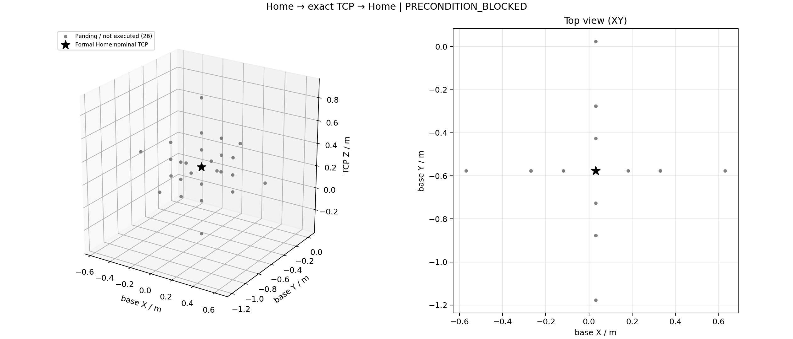

# Home 到点往返工具验收

2026-10-25。**工具及离线/模拟回环就绪；真实范围探索前置条件阻塞，不能报全部完成。**

本轮真实 Home→目标→Home 成功 **0**，26 个粗扫点全部待测，六方向边界探测/加密未执行。
当前设备绝对再现/缩减速度和加速度上限尚无可复核来源；通用官方 Nova5 配置不是本机合法极限。
工具的真实 execute 入口已验证会在启动业务节点/连接真实控制器之前拒绝，错误为：

> current controller absolute velocity/acceleration limits unknown; no motion

记录：`runs/home_roundtrip_20261025/tool-precondition-final/results.json`。该目录无 node.log、
command.json 或 audit，未启动实际节点，更没有运动。下图灰色均是有限清单，不是规划通过/实机到位。

## 正式 Home 与有限清单

沿用两份正式 Home YAML，SHA256 均为
`165f3ec9727f78bd5069538aa0029fd96275574dfd882db472a08b36a1be634a`，未重新定义或清零参考。
对应标称 TCP 为 `[0.0303514019, -0.5765188179, 0.2749875911] m`，朝向固定为其原朝向。
Home 图标表示正式配置的标称 TCP，并不证明当前机器人已在该点。

清单 `manifest.json` 包含：±X/±Y/±Z 六方向各 0.15、0.30、0.60 m，共 18 点；Home 上下
0.15 m 两高度各左右前后 0.30 m 四点，共 8 点。方向定义为基座坐标轴。部分远/低点将因工作区、
桌面、运动学或其他保护被拒绝，保存其原因而不强行执行。全范围约 X=-0.570…0.630 m、
Y=-1.177…0.023 m、Z=-0.325…0.875 m；这是候选清单包围盒，不是可达空间。

每方向最多再用 2 个边界槽，共 38 个不同目标硬上限；包括低/高档资格最多 40 次往返尝试，
可选初始 Home 恢复再加 1 段，最多 81 段运动。初始估时 10–25 分钟；资格门禁解除后，
首个目标运动前由节点实际双向预检修正运动时间估算。若全部远点通过，槽位可先查配置工作区边缘；
仍未闭合者明确 unbracketed，不冒称全局最远/全空间已测完。

## 实现与保护

入口为 `tools/testing/arm_roundtrip.py`，文档 `arm_roundtrip_README.md`。使用原有 PREGRASP +
HOME action，零 approach_clearance，无隐藏坐标偏置。父节点新支持只复制扭转历史的去返预检：
每个去程 IK 候选必须通过预计终点→正式 Home 的返程检查，不能用当前 Home→Home 的零路径代替。
实际只执行去程，到位后另发 HOME；两段都由新鲜、同步关节/state/TCP 反馈确认，才算该目标成功。

实时参考经原 RestoreReference 服务恢复完整原始历史，需真实用户无外部运动/拖拽/复位声明。
工具不调用 InitializeReference、ClearError 或 Enable；没有独立 TCP 运动通道。不输入旧轨迹
作为运动命令。任一执行故障中止批次，观察并记录新鲜 mode=5 停稳 dwell，不强行发 Home。

默认当前必须已经在正式 Home；显式 `--recover-home` 才会在来源限值及历史恢复通过后，先通过
同一节点计划/执行一次 low HOME，并实测到位。该恢复独立记账，不算目标成功，不重定义参考。

绝对控制器限值文件含型号、完整固件、来源、6 轴数值和 rad/s / rad/s² 单位，不接受百分比推导
或 `verified=true` 开关。与官方上限取更严格者，实际写入本次节点 limits/profile，保存请求/有效值。
无已有真实两档证据时，同一工具选清单内一个余量合格点，low 往返、高档往返均实测成功才继续。
证据绑定二进制、源码、Home/TCP、URDF/geometry、SDK、profile/限值来源、IP/固件与非模拟反馈。
不把该局部档位验证称作机械物理最大速度认证。

## 已完成验证与实际未完成项

| 项目 | 证据 / 结果 |
|---|---|
| 父节点新增预检 | Arm 57 + Twist 20 回归通过；父侧记录 `unit02.log` |
| 工具纯逻辑 | 16/16 通过，`parent-tool-unit-final03.log`，含逐点重规划重选档及 handle 丢失受控关闭/不重发 |
| 实际业务节点模拟回环 | `tool-loopback-final02/result.json` PASS、8 类事件、simulation=true |
| 模拟资格 | 同一 action 链执行 low/high 两次往返，证据保持 simulated=true，不能用于真实模式 |
| 模拟冷启动恢复 | 模拟离 Home 0.03 rad，计划 low HOME→反馈到位→档位资格，参考未清零 |
| 模拟普通点 | 2 个非零实际 TCP 目标均完成去/回；其中资格点复用，1 个工作区拒绝后继续 |
| 模拟执行失败 | 成功 ACK 但编码器冻结：去程失败，Stop 反馈确认，未强行发返程 |
| 去返余量增量核对 | `tool-margin-pair-final/result.json` PASS；8 去程采样+3 预计返程采样，末点正式 Home；不发送运动 |
| 真实范围 | 0 往返、26 待测、6 方向边界均未执行 |

父侧真实只读审计已经确认旧 9 份历史可衔接，当前 mode=5、参考有效、时间戳一致；当前真实
TCP 约 `[0.0678725,-0.3331955,0.3059153] m`，**不在正式 Home**。current→Home 的 1.74 s
规划及余量检查通过只是计划，不算 Home 到位；具体原始证据由父侧 `current_readonly01/02` 保存。

模拟图/结果与真实待测图分开，不能将模拟绿色点混到实际范围。正式执行解除阻塞后可用相同工具、
新输出目录继续；不自动续跑失败批次。保存结果包括坐标、去返预检、各段到位误差/耗时、失败原因、
raw feedback/audit、逐动作计划及四类状态三维图。

独立审查的两项定向修复已完成：全批缓存只作预检/估时，每次实际去程前重新计划和选档；
余量 evaluator 包含预计返程的同一关节直线路径。goal handle 等待超时按执行接受状态歧义处理，
立刻请求业务节点受控 shutdown/Stop，不重发，并明确停稳未确认，不能把进程退出当作机械停稳。

还需要：当前型号/控制器的合法绝对限值来源；随后显式恢复正式 Home、实测两档资格、26 点清单和
有限边界加密。没有这些证据，不能把当前软件/回环验收算作实机工作区验收完成。

父代理最终修补并回归通过：继承探索配置的停稳 0.002 rad/s / dwell 0.4 s、到位 1 mm / 0.005 rad / 0.0005 rad，未放宽既有探索保护；资格上下文加入完整运动参数与配置哈希。每次发请求前处理 ROS 订阅并等待原始时间戳的新鲜同步快照，避免余量计算后的客户端缓存误超时；反馈消失时仍保存真实 action 错误结果。最终模拟回环及 16 项工具回归均通过。
