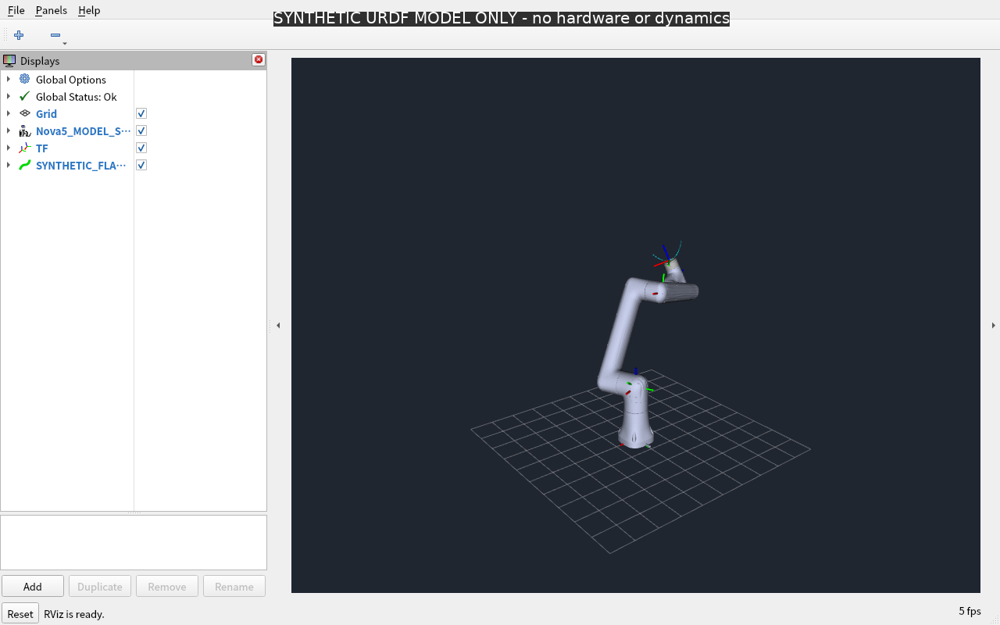
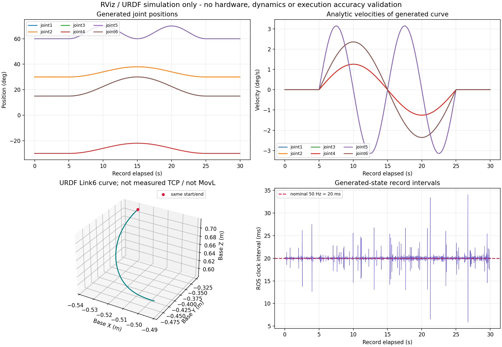

# Nova5 RViz 模型与模拟运动检查

日期：2026-10-20（Asia/Taipei）。用户补充确认：**机器目前未连接，本轮只用 RViz，不使用实际机器。** 原始实机验收目标不再作为本轮完成条件；所有实机接口和运动执行仍记为未测，不能用本报告替代实机验收。

## 结果

已在6021上实际启动 RViz2，加载原厂 URDF/STL，完成模型显示和30秒模拟状态播放。RViz截图显示 `Global Status: Ok`，模型、TF轴和由URDF计算的末端路径可见。没有连接控制器、启动旧控制程序或改动原厂零速度/零力矩限值。

当前 Jetson 桌面没有可用的显示授权，因此将 Ubuntu 仓库的签名 xvfb 软件包下载解包到被忽略的运行目录，使用单独认证、禁止TCP监听的虚拟X显示及Mesa软件渲染；没有安装系统包或绕过原桌面授权。录制结束后本次 RViz、虚拟显示和发布节点均已退出。录像为31秒、1280×800、10fps；画面实际RViz刷新约5–7fps，**并非50fps动画或实时控制性能测试**。

## 范围与判定

| 项目 / 条件与步骤 | 预期与阈值依据 | 实际结果 | 判定与证据 |
|---|---|---|---|
| 编译新增C++模拟节点 | 6021原生colcon退出0，无warning/error | 符合 | 通过；`build_capture.txt` |
| RViz加载模型、网格与TF | 无丢失资源；全局状态OK；完整机械臂可见 | 截图已视觉核对，状态OK、模型可见，无裁切 | 通过（显示项）；`rviz_synthetic_mid.png`、`rviz_synthetic_late.png`、`rviz_demo.txt` |
| 关节单位、顺序、TF计算 | `joint1..joint6`，deg→rad；Eigen/KDL和TF离线阈值沿用前报告 | 13姿态TF检查最大位置差6.31e-16 m、角差1.76e-15 rad | 通过（模拟链路）；上轮原始CSV与本轮`tf_trial.txt` |
| 30秒模拟播放 | 5秒起点保持+20秒平滑闭合关节曲线+5秒保持；位置在原URDF范围内；缩放Jacobian min sv>=0.05、condition<=80（运行前写入代码的工程筛选） | 1500帧，记录时长29.9803s；min sv=0.16690023，最大condition=12.13052335，无位置越界 | 通过（生成的模型轨迹）；`synthetic_motion.csv`、`demo_result.txt` |
| 数据生成频率 | 目标50Hz；报告真实记录间隔，不把视频帧率当数据频率 | 中位19.9975ms，P95 20.5371ms，最大34.0741ms；按中位数约50.006Hz | 已记录；不宣称硬实时；`simulation_summary.json` |
| 模拟速度单位/连续性 | 解析速度以deg/s生成，ROS以rad/s发布；有限差分仅作辅助数值比较，未另设验收阈值 | 峰值按关节约[2.3562,1.2566,3.1416,1.2566,3.1416,2.3562]deg/s；位置差分对解析速度最大差0.0001108deg/s | 数值结果已记录；不是实机速度跟踪或额定限值测试 |
| 回到起点 | 同一解析模型的闭合轨迹回到初始关节值 | 生成值起终点关节差0deg、URDF Link6位置差0m | 通过（生成轨迹自身）；不是定位误差测量 |
| 原厂FK/IK、实机反馈、MovJ/MovL、停止/暂停/继续、限速/加速度、真实TCP精度 | 需要设备和原任务所列现场条件 | 无控制器、0真实帧、0控制器命令 | **未测，本轮范围外** |

## 具体模拟动作与坐标

- 起始/结束关节角：[15,30,60,-30,60,15]deg。
- 各关节变化范围分别为：[15,30]、[30,38]、[60,70]、[-30,-22]、[60,70]、[15,30]deg；仅用于模型显示，不是实机动作许可。
- 曲线为 `q_j(t)=base_j+amplitude_j/2*(1-cos(2π*h_j*t/20))`，t∈[0,20]s；谐波h=[1,1,2,1,2,1]。起止速度为0；该函数没有模拟电机、驱动器、负载、控制器插补或跟踪误差。
- 固定坐标系为`base_link`。青色路径为URDF的`Link6`原点，由模型正解计算；**不是实测TCP，也不是MovL直线指令**。关节1/6和3/5使用相同生成曲线，数据图中有重叠线。
- 只检查URDF的位置边界和Jacobian筛选；未把URDF的`velocity=0/effort=0`当作可用动态配置，也没有确认碰撞、自碰撞或实机方向/零位。

## 文件与复现

- C++节点：`src/chess_robot_validation/src/rviz_demo.cpp`，只发布`/validation/synthetic_joint_states`和`/validation/synthetic_flange_path`，无socket或控制器API。
- RViz配置：`src/chess_robot_validation/config/nova5.rviz`，显示名称标明模拟。
- 便捷启动：在6021有授权的图形桌面中执行 `bash tools/validation/run_rviz_simulation.sh`。它启动本次的robot_state_publisher/RViz，播放一次30秒曲线，生成CSV/图表，窗口保留到手动关闭。使用独立ROS_DOMAIN_ID=62、ROS_LOCALHOST_ONLY=1；不要与前一套模拟发布者同时运行。
- 无桌面的本次具体录制脚本、Xvfb日志及参数保留于`runs/20261020_nova5_rviz/`；主数据位于其`final/`子目录。X授权文件及解包运行时不进入Git或交付压缩包。
- 主要输出：`rviz_synthetic_demo.mp4`、`rviz_synthetic_late.png`、`rviz_simulation_data.png`、带时间/单位的`synthetic_motion.csv`、`simulation_summary.json`、代码/证据SHA256与版本快照。CSV的`record_ros_time_ns`为生成状态记录时钟，非真实反馈接收时刻；`synthetic_time_s`在前后保持段分别固定为0和20。
- 文本、代码与小型数据图保存到仓库；视频、原始CSV、运行日志单独留在Git忽略目录，另提供交付压缩包。不提交凭据或大体积运行文件。

原报告`nova5-2026-10-20.md`保留为历史只读调查记录。那里关于“没有可访问桌面”的记录是当时事实；本次通过独立虚拟显示完成RViz画面检查。关于真实机械臂的未测项没有改变。
