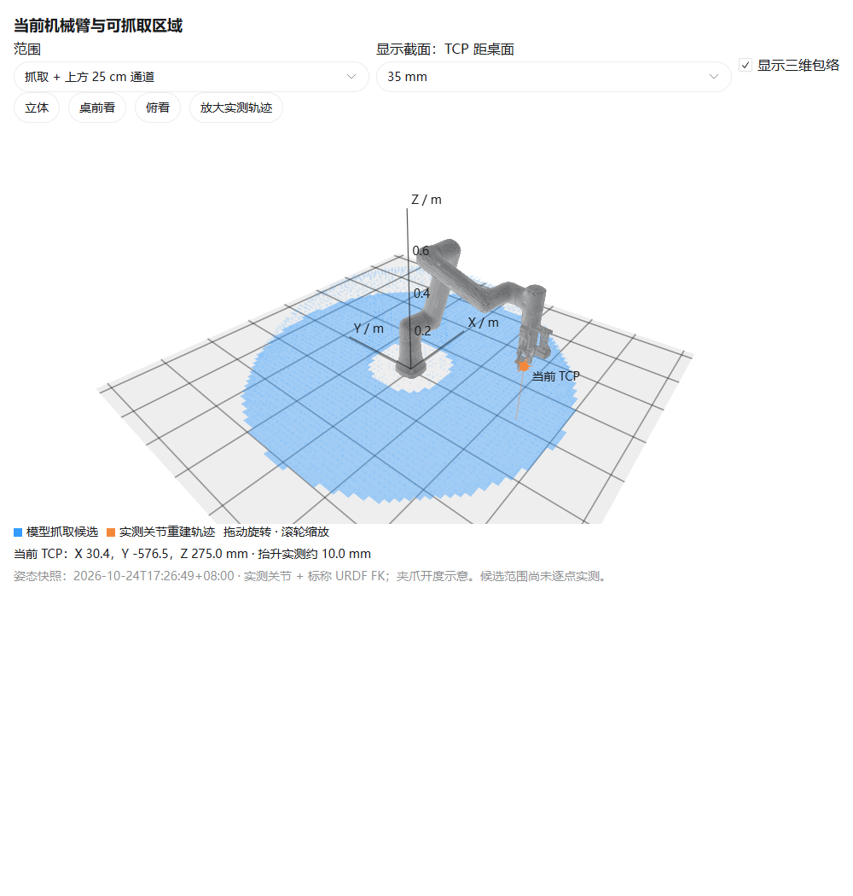

# 当前姿态参考图与一次小范围实机验证

2026-10-24。此前工作区图来自离线 URDF 分析，未执行实机运动。
本轮用户明确授权真实移动，并在示教器切换 TCP 控制后，完成一次 Home 附近的上抬与回位。

## 图中的姿态

机械臂六轴姿态来自本轮运动后 366 帧真实反馈的中位数，再通过当前 URDF 重建外形和 TCP。
夹爪开度没有采集，图中采用 0.47 rad 示意；网格为显示而简化，不替代碰撞模型。
可旋转的三维图在对话中，支持桌前、俯视及实测轨迹放大；切换高度只改变工作区截面，不移动实机。

## 实际执行了什么

- 初始状态：mode=5，但非 TCP；用户切换模式后，只读查询确认 TCP 可用、已使能且静止。
- 局部目标：在当时姿态上方 10 mm，再回原关节位置。未扫描工作区边界。
- 运动前检查：局部关节插值、关节箱体角点和随机组合共 1,165 个配置，全部通过本模型地面
  20 mm 余量、非相邻包络 10 mm 间隔及奇异性检查；最小归一化奇异值约 0.201。
- 使用独立维护工具 `MovJ(joint=...)`，两段均为 `a=1, v=1, cp=0`，关节到位容差 0.001 rad，
  静止停留 0.4 s。执行期间没有业务控制节点同时发送运动。
- 两段各发送一次，均返回 HOME_REACHED：指令队列匹配、真实关节到位、低速且 mode=5 持续停留。
  没有报错、重复发送或自动重试；正式 Home 和业务配置未改。

| 记录 | 抬升 | 回位 |
|---|---:|---:|
| 反馈帧 | 250 | 253 |
| 记录时长（含停留） | 2.72 s | 2.72 s |
| 峰值实测关节速度 | 0.0187 rad/s | 0.0187 rad/s |
| 实测状态 | mode 5、7 | mode 5、7 |

实测关节通过标称 URDF FK 重建，上抬 Z 约 10.004 mm，回位点与初始点的重建差约 0.008 mm。
**这些数值是编码器与模型的一致性，不是独立 TCP 测量或机械绝对精度认证。**

本次只验证当前位置附近这段小运动，不代表整幅工作区已实测，也未验证 Stop 的实机延迟。
全局工作区仍是上一份报告中的离线候选范围，TCP、环境和线缆的完整标定仍待完成。

## 记录与复现边界

原始反馈：`small-motion-20261024/lift.csv`、`return.csv`；执行状态：`execution.json`；
局部预筛选：`plan.json`；编码器重建结果：`measured_result.json`。
AGX 原始工作目录为 `runs/local_motion_20261024`。

维护工具新增可选 `--record-feedback NEW_CSV_PATH`，只记录该次调用读取到的反馈，拒绝覆盖已有日志。
已通过 11 个原 C++ 测试，以及新增反馈记录断言的 localhost 协议测试。
一次性实机动作脚本保存在 runs，不作为会自动重放运动的测试或构建步骤提交。
